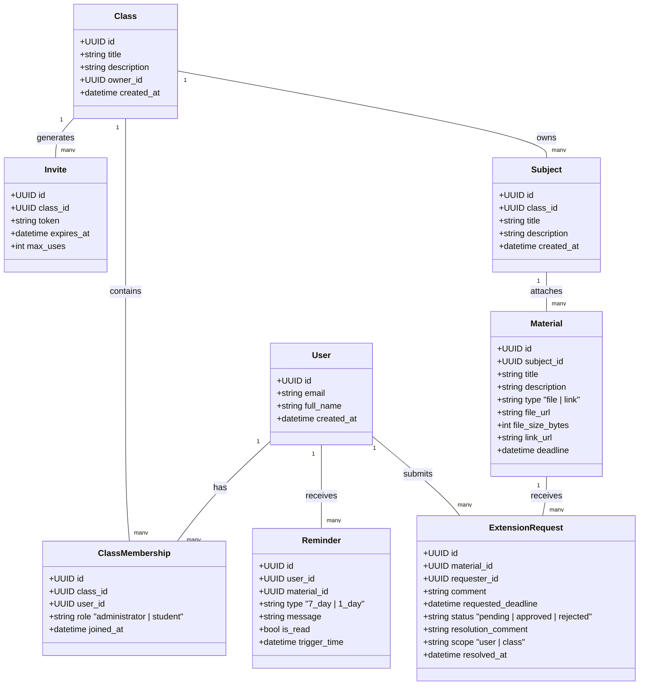

# REST API Architecture & Resource Design

**Project:** LabManager (Educational Materials and Laboratory Manager)  
**Document Version:** 1.0  
**OpenAPI Specification:** `spec/openapi.yaml`  
**Base Path:** `/api/v1`  
**Protocol:** HTTPS  
**Standard Error Format:** RFC 7807 (`application/problem+json`)

---

## 1. Domain Resource Decomposition & Boundary Identification

Based on `spec/srs.md` (v1.0), the domain is decomposed into the following core REST resources, respecting domain hierarchies and contextual role permissions:



### Resource Hierarchy & URL Convention:
- `/api/v1/auth` - Authentication & user identity
- `/api/v1/classes` - Top-level class container
- `/api/v1/classes/{classId}/members` - Contextual membership and roles within a class
- `/api/v1/classes/{classId}/invites` - Class invite management
- `/api/v1/invites/{token}/join` - Universal join endpoint using invite token
- `/api/v1/classes/{classId}/subjects` - Subjects bound strictly to a class (`Class -> Subject`)
- `/api/v1/classes/{classId}/subjects/{subjectId}/materials` - Materials bound to a subject
- `/api/v1/calendar` & `/api/v1/classes/{classId}/calendar` - Calendar view of deadlines
- `/api/v1/reminders` - Automated notifications and reminder engine
- `/api/v1/classes/{classId}/extension-requests` - Student requests and admin approval workflow

---

## 2. API Operations Matrix & REQ-ID Mapping

| Operation ID | Method | URI Path | Scope / Roles | REQ-ID | Description |
| :--- | :--- | :--- | :--- | :--- | :--- |
| `registerUser` | `POST` | `/api/v1/auth/register` | Public | **REQ-F-001** | Register a new user account |
| `loginUser` | `POST` | `/api/v1/auth/login` | Public | **REQ-F-001** | Authenticate user & issue JWT token |
| `getCurrentUser` | `GET` | `/api/v1/auth/me` | Authenticated | **REQ-F-001**, **REQ-NF-002** | Get current profile & class roles |
| `createClass` | `POST` | `/api/v1/classes` | Authenticated | **REQ-F-002** | Create a new class (creator becomes Admin) |
| `listClasses` | `GET` | `/api/v1/classes` | Authenticated | **REQ-F-002**, **REQ-NF-002** | List classes for user with role badge |
| `getClassById` | `GET` | `/api/v1/classes/{classId}` | Member | **REQ-F-002** | Get class workspace details |
| `generateInvite` | `POST` | `/api/v1/classes/{classId}/invites` | Administrator | **REQ-F-003** | Generate class invite link/token |
| `joinClassByInvite` | `POST` | `/api/v1/invites/{token}/join` | Authenticated | **REQ-F-003** | Join class as Student (Scenario 1) |
| `listClassMembers` | `GET` | `/api/v1/classes/{classId}/members` | Member | **REQ-F-004** | List roster of class members |
| `updateMemberRole` | `PATCH` | `/api/v1/classes/{classId}/members/{userId}/role` | Administrator | **REQ-F-004** | Promote Student to Administrator |
| `createSubject` | `POST` | `/api/v1/classes/{classId}/subjects` | Administrator | **REQ-F-005** | Create academic subject under class |
| `listSubjects` | `GET` | `/api/v1/classes/{classId}/subjects` | Member | **REQ-F-005** | List all subjects in class |
| `getSubjectById` | `GET` | `/api/v1/classes/{classId}/subjects/{subjectId}` | Member | **REQ-F-005** | Get subject details |
| `createMaterial` | `POST` | `/api/v1/classes/{classId}/subjects/{subjectId}/materials` | Administrator | **REQ-F-006**, **REQ-NF-001** | Upload file (<500MB) or add link |
| `listMaterials` | `GET` | `/api/v1/classes/{classId}/subjects/{subjectId}/materials` | Member | **REQ-F-006** | List materials attached to subject |
| `getMaterialById` | `GET` | `/api/v1/classes/{classId}/subjects/{subjectId}/materials/{materialId}` | Member | **REQ-F-006** | Get material details & deadline |
| `downloadMaterialFile` | `GET` | `/api/v1/classes/{classId}/subjects/{subjectId}/materials/{materialId}/download` | Member | **REQ-F-006** | Download material file binary |
| `getClassCalendar` | `GET` | `/api/v1/classes/{classId}/calendar` | Member | **REQ-F-007** | Get deadlines in calendar for class |
| `getGlobalCalendar` | `GET` | `/api/v1/calendar` | Authenticated | **REQ-F-007** | Get aggregated user calendar |
| `assignMaterialDeadline` | `PUT` | `/api/v1/classes/{classId}/subjects/{subjectId}/materials/{materialId}/deadline` | Administrator | **REQ-F-007** | Set/update deadline on material |
| `listReminders` | `GET` | `/api/v1/reminders` | Authenticated | **REQ-F-008** | Get 7-day and 1-day reminders |
| `markReminderRead` | `PATCH` | `/api/v1/reminders/{reminderId}/read` | Authenticated | **REQ-F-008** | Mark notification as read |
| `submitExtensionRequest` | `POST` | `/api/v1/classes/{classId}/materials/{materialId}/extension-requests` | Student | **REQ-F-009** | Submit deadline extension request |
| `listExtensionRequests` | `GET` | `/api/v1/classes/{classId}/extension-requests` | Member | **REQ-F-009** | List pending/resolved requests |
| `decideExtensionRequest` | `PATCH` | `/api/v1/classes/{classId}/extension-requests/{requestId}/decision` | Administrator | **REQ-F-010** | Approve or reject extension request |

---

## 3. Standard Error Model (RFC 7807 / RFC 9457)

All error responses across the API use `Content-Type: application/problem+json` with a consistent schema:

```json
{
  "type": "https://labmanager.edu/errors/file-too-large",
  "title": "Payload Too Large",
  "status": 413,
  "detail": "File exceeds the 500MB limit. Maximum allowed size is 524288000 bytes.",
  "instance": "/api/v1/classes/cls_101/subjects/sbj_202/materials",
  "invalid_params": [
    {
      "name": "file",
      "reason": "File size 629145600 bytes exceeds 524288000 bytes limit."
    }
  ]
}
```

### Standard Status Codes:
- `200 OK`: Request succeeded.
- `201 Created`: Resource successfully created.
- `204 No Content`: Successful action with no content returned.
- `400 Bad Request`: Malformed syntax or request query/body.
- `401 Unauthorized`: Missing or invalid Bearer JWT token.
- `403 Forbidden`: Authenticated user lacks permission (e.g. Student attempting admin operations).
- `404 Not Found`: Target resource URI does not exist.
- `409 Conflict`: Conflict state (e.g. duplicate user email, user already in class, already pending extension).
- `413 Payload Too Large`: Uploaded file exceeds 500MB (REQ-NF-001).
- `422 Unprocessable Entity`: Semantic validation failures (invalid fields, comments empty, bad dates).
