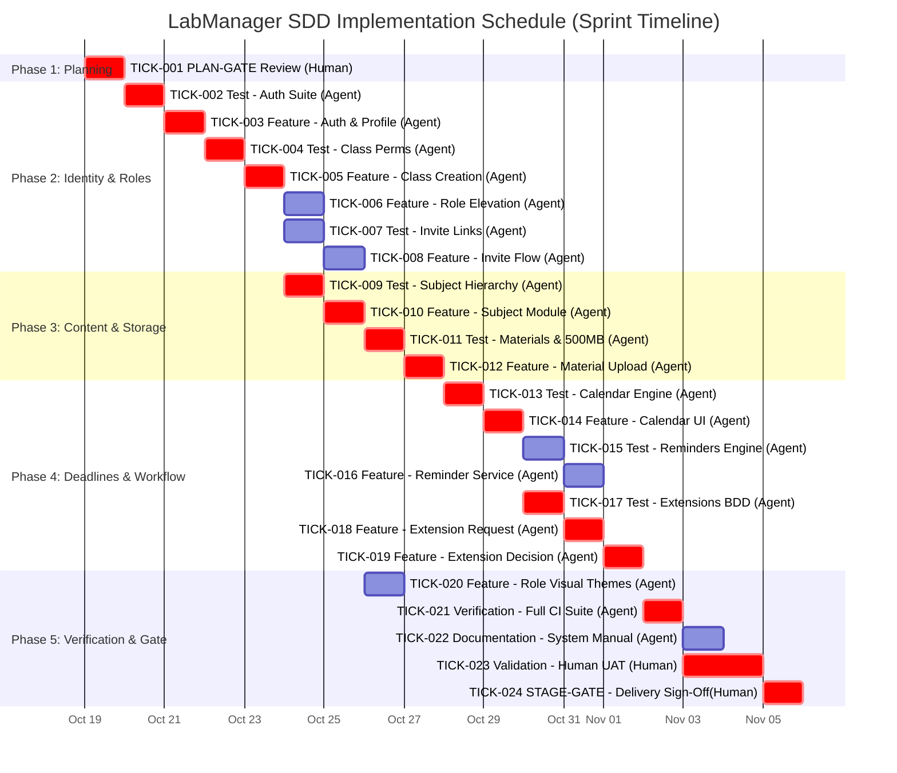

# Project Execution Plan, Schedule & Critical Path

**Project:** LabManager  
**Methodology:** Specification-Driven Development (SDD) with Human-in-the-Loop  
**Baseline:** `spec/srs.md`, `docs/tickets.md`  

---

## 1. Phased Execution Roadmap

The implementation is partitioned into 5 sequential and parallel stages governed by strict entry and exit criteria.

### Phase 1: Planning, Decomposition & Gate Review
- **Focus:** Complete specification decomposition, dependency mapping, and risk register.
- **Milestone Checkpoint:** **TICK-001 (PLAN-GATE)**.
- **Entry Criteria:** Approved SRS v1.0, BDD scenarios, traceability matrix.
- **Exit Criteria:** Human Reviewer formal `GO` sign-off.

### Phase 2: User Identity & Contextual Role Foundation
- **Tickets:** TICK-002, TICK-003, TICK-004, TICK-005, TICK-006, TICK-007, TICK-008.
- **Deliverables:** Working authentication, class generation, contextual Admin/Student assignment, and invite links.

### Phase 3: Subject Structure & File Storage Engine
- **Tickets:** TICK-009, TICK-010, TICK-011, TICK-012.
- **Deliverables:** Strict Class -> Subject hierarchy, file/link upload service enforcing 500MB cap (REQ-NF-001).

### Phase 4: Deadlines, Reminders & Extension Requests
- **Tickets:** TICK-013, TICK-014, TICK-015, TICK-016, TICK-017, TICK-018, TICK-019.
- **Deliverables:** Calendar component, automated 7-day/1-day reminder engine, formal extension request and approval flow.

### Phase 5: Verification, Human Validation & Final Delivery
- **Tickets:** TICK-020, TICK-021, TICK-022, TICK-023, TICK-024.
- **Deliverables:** UI role differentiation, 100% CI automated test pass, user documentation, human intent validation, and final **STAGE-GATE** sign-off.

---

## 2. Work Effort & Human Duration Modeling

In an AI-augmented development workflow, the AI Coding Agent executes code and test generation rapidly (measured in minutes), whereas **Human Reviewer actions** (verification of intent, code review, safety audits, and gate decisions) represent the primary throughput constraint and real-time bottleneck.

| Ticket ID | Ticket Title | Assigned Role | Agent Execution Time | Human Review / Action Time | Total Calendar Duration |
| :--- | :--- | :--- | :--- | :--- | :--- |
| **TICK-001** | PLAN-GATE Approval | Human Reviewer | 10 min (Prep) | 2.5 h (Thorough Review) | **2.5 hours** |
| **TICK-002** | Test: Auth Suite | AI Coding Agent | 20 min | 15 min (Review) | **35 min** |
| **TICK-003** | Feature: Auth & Profile | AI Coding Agent | 45 min | 30 min (Code Review) | **1.25 hours** |
| **TICK-004** | Test: Class & Permissions | AI Coding Agent | 20 min | 15 min | **35 min** |
| **TICK-005** | Feature: Class Creation & Admin | AI Coding Agent | 40 min | 25 min | **1.1 hours** |
| **TICK-006** | Feature: Role Assignment | AI Coding Agent | 30 min | 20 min | **50 min** |
| **TICK-007** | Test: Invite Joining (BDD 1) | AI Coding Agent | 20 min | 15 min | **35 min** |
| **TICK-008** | Feature: Invite Flow | AI Coding Agent | 35 min | 20 min | **55 min** |
| **TICK-009** | Test: Subject Hierarchy | AI Coding Agent | 20 min | 15 min | **35 min** |
| **TICK-010** | Feature: Subject Management | AI Coding Agent | 35 min | 20 min | **55 min** |
| **TICK-011** | Test: Material & 500MB (BDD 3)| AI Coding Agent | 25 min | 20 min | **45 min** |
| **TICK-012** | Feature: Material Attachment | AI Coding Agent | 50 min | 30 min | **1.3 hours** |
| **TICK-013** | Test: Calendar & Deadlines | AI Coding Agent | 25 min | 15 min | **40 min** |
| **TICK-014** | Feature: Calendar Component | AI Coding Agent | 55 min | 35 min | **1.5 hours** |
| **TICK-015** | Test: Reminders Service | AI Coding Agent | 20 min | 15 min | **35 min** |
| **TICK-016** | Feature: Reminder Engine | AI Coding Agent | 40 min | 20 min | **1.0 hour** |
| **TICK-017** | Test: Extensions (BDD 2) | AI Coding Agent | 25 min | 20 min | **45 min** |
| **TICK-018** | Feature: Extension Request | AI Coding Agent | 35 min | 20 min | **55 min** |
| **TICK-019** | Feature: Extension Decision | AI Coding Agent | 40 min | 25 min | **1.1 hours** |
| **TICK-020** | Feature: UI Role Distinction | AI Coding Agent | 35 min | 25 min | **1.0 hour** |
| **TICK-021** | Verification: CI & Lint Suite | AI Coding Agent | 20 min | 15 min | **35 min** |
| **TICK-022** | Documentation: Docs & Trace | AI Coding Agent | 35 min | 25 min | **1.0 hour** |
| **TICK-023** | Validation: Human UAT & Intent | Human Reviewer | 15 min (Support)| 3.0 h (Hands-on UAT) | **3.0 hours** |
| **TICK-024** | STAGE-GATE: Delivery Sign-Off | Human Reviewer | 0 min | 1.5 h (Decision Audit) | **1.5 hours** |

---

## 3. Critical Path Analysis (CPM)

The Critical Path Method (CPM) identifies the sequence of dependent tasks that directly determines the minimum project completion time. A delay in any task on this path will postpone the overall project delivery.

### Critical Path Sequence:
1. **TICK-001** (PLAN-GATE)
2. **TICK-002** (Test: Auth Suite)
3. **TICK-003** (Feature: Auth & Profile)
4. **TICK-004** (Test: Class & Permissions)
5. **TICK-005** (Feature: Class Creation & Admin)
6. **TICK-009** (Test: Subject Hierarchy)
7. **TICK-010** (Feature: Subject Management)
8. **TICK-011** (Test: Material Upload & 500MB Limit)
9. **TICK-012** (Feature: Material Attachment Service)
10. **TICK-013** (Test: Calendar & Deadlines)
11. **TICK-014** (Feature: Calendar Component)
12. **TICK-017** (Test: Extensions Lifecycle)
13. **TICK-018** (Feature: Extension Request Form)
14. **TICK-019** (Feature: Extension Decision & Shifter)
15. **TICK-021** (Verification: Automated CI Suite)
16. **TICK-023** (Validation: Human Intent & UAT)
17. **TICK-024** (STAGE-GATE: Final Sign-off)

### Non-Critical Path Tasks (with Float / Slack):
- **TICK-006** (Feature: Role Assignment) — Can run concurrently after TICK-005 without blocking Phase 3.
- **TICK-007 / TICK-008** (Invite Link Test & Feature) — Can run in parallel with Phase 3 once TICK-005 completes.
- **TICK-015 / TICK-016** (Reminder Engine) — Can run concurrently with Extension flow once TICK-014 completes (Float: ~2.5 hours).
- **TICK-020** (UI Role Differentiation) — Depends on TICK-006 & TICK-008; executed before final verification (Float: ~3.0 hours).
- **TICK-022** (Documentation) — Runs in parallel with Human Validation TICK-023 (Float: ~1.5 hours).

---

## 4. Mermaid Gantt Schedule Diagram

