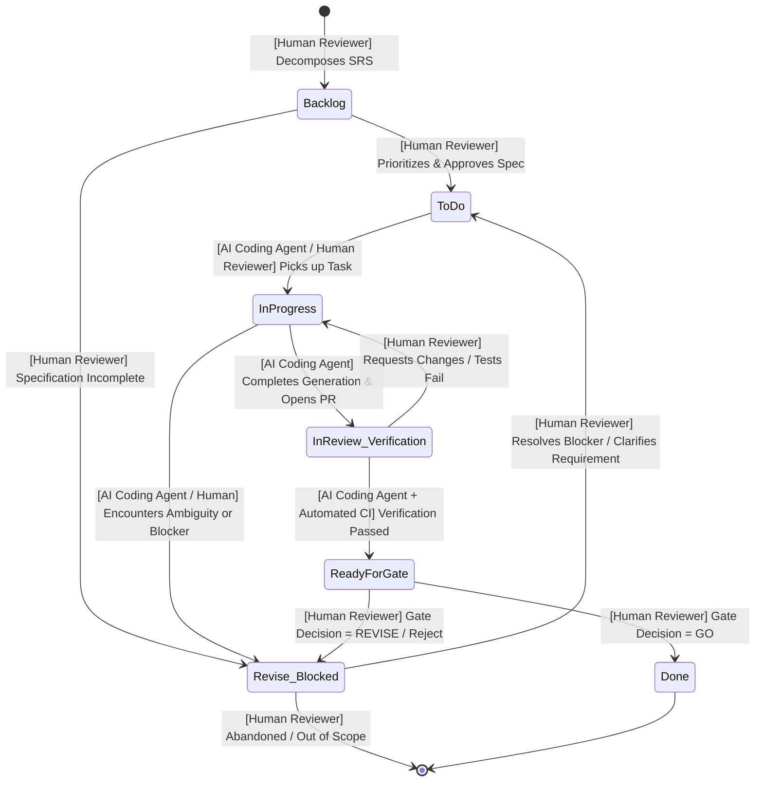

# SDD Workflow and Issue Tracking Specification

**Project:** LabManager  
**Roles:** Human Reviewer, AI Coding Agent  
**Platform:** GitHub Issues & GitHub Projects  

---

## 1. Issue Tracking System Setup (GitHub Issues & Projects)

GitHub Issues combined with GitHub Projects (Kanban Board) is configured as the official project tracking system. It provides native versioning, commit/PR linking, labeling, and milestone management directly within the codebase repository.

### 1.1 Custom Fields & Metadata
- **Status:** Backlog, To Do, In Progress, In Review / Verification, Ready for Gate, Done, Revise / Blocked.
- **Type:** Label-based classification (`type:spec`, `type:test`, `type:feature`, etc.).
- **Assignee:** Human Reviewer, AI Coding Agent, or Collaborative (Co-assigned).
- **Requirement Reference:** Exact mapping to SRS ID (e.g., `REQ-F-001`).
- **Dependencies:** `Blocked by: #<ID>`, `Blocks: #<ID>`.

---

## 2. Ticket Types in the SDD (Specification-Driven Development) Cycle

| Ticket Type | GitHub Label | SDD Cycle Purpose | Primary Responsible Role |
| :--- | :--- | :--- | :--- |
| **Specification** | `type:spec` | Defines or refines baseline functional and non-functional requirements. | Human Reviewer (Input from Agent) |
| **Addendum** | `type:addendum` | Formal change request or extension to requirements identified during planning or implementation. | Human Reviewer |
| **Test** | `type:test` | Implementation of automated unit tests, integration tests, or BDD test fixtures prior to or in conjunction with feature code. | AI Coding Agent (Reviewed by Human) |
| **Feature** | `type:feature` | Concrete implementation of business logic, backend components, or frontend UI strictly adhering to SRS. | AI Coding Agent |
| **Verification** | `type:verification` | Objective technical checks: automated test execution, static analysis, linting, type-checking, and build validation. | AI Coding Agent (Automated CI) |
| **Validation** | `type:validation` | Subjective domain and user intent confirmation against acceptance criteria and usability goals. | Human Reviewer (Non-delegable) |
| **Documentation** | `type:doc` | Architecture summaries, user manuals, API docs, and traceability logs. | AI Coding Agent (Reviewed by Human) |
| **Gate** | `type:gate` | Decision checkpoint (GO / REVISE / ABORT) authorizing the transition to subsequent phases. Produces no code. | Human Reviewer (Strictly Human Authority) |

---

## 3. Workflow Statuses & Definitions

1. **Backlog:** Item decomposed and prioritized, but not yet scheduled for the active iteration.
2. **To Do:** Specification and prerequisite dependencies met; task is ready for execution.
3. **In Progress:** Work actively being generated by the assigned role (Agent writing code/tests, or Human drafting spec).
4. **In Review / Verification:** Code/tests submitted; automated verification suite runs, and Human Reviewer conducts peer review.
5. **Ready for Gate:** All implementation, testing, and verification tasks for a milestone are satisfied; awaiting formal Stage-Gate assessment.
6. **Done:** Successfully validated, merged, and traced back to the requirement matrix.
7. **Revise / Blocked:** Blocked by unmet upstream dependencies or returned by a Gate decision for requirement/design revision.

---

## 4. Lifecycle Diagram with Role Transitions

Below is the state machine diagram of an SDD work item. Each transition between states is explicitly attributed to the authorized role.

---

## 5. Role Distribution and Responsibility Boundaries

### 5.1 Strictly Non-Delegable Human Actions (Human Reviewer)
- **Gate Authority:** Only the Human Reviewer can grant `GO` at stage-gates (`SPEC-GATE`, `PLAN-GATE`, `PROD-GATE`).
- **Validation of Intent:** Confirmation that implemented UI and behaviors match user mental models and non-functional usability goals (`REQ-NF-002`).
- **Scope Baseline & Addenda:** Approving additions or modifications to the functional baseline.

### 5.2 Agent Autonomous Operations (AI Coding Agent)
- Initial requirement decomposition and dependency suggestions.
- Generation of test scaffolding (unit tests, BDD step definitions) based on acceptance criteria.
- Feature code implementation according to specifications.
- Automated code formatting, linting, and bug fixing based on error logs.
- Draft creation of documentation and traceability updates.

### 5.3 Collaborative (Human-in-the-Loop) Operations
- Pair review of generated PRs and code diffs.
- Analyzing edge cases during risk assessment.
- Clarifying ambiguous domain logic (SKED dialogue).
